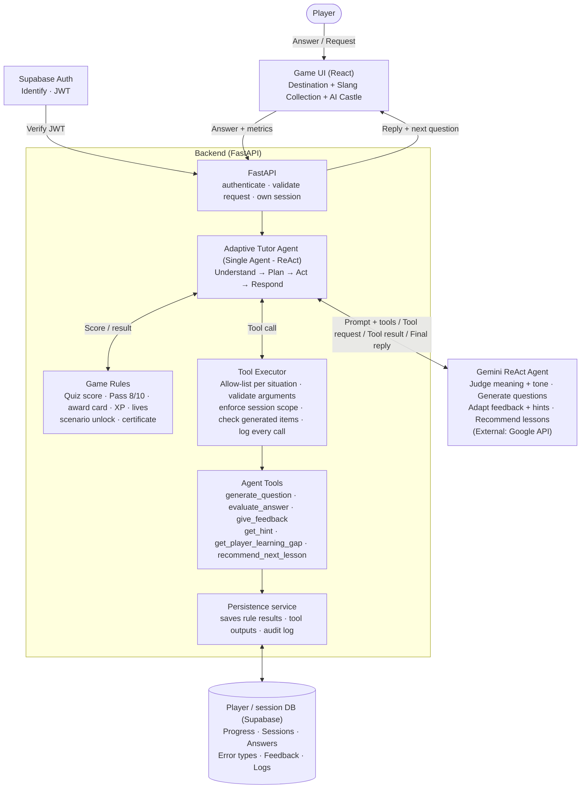
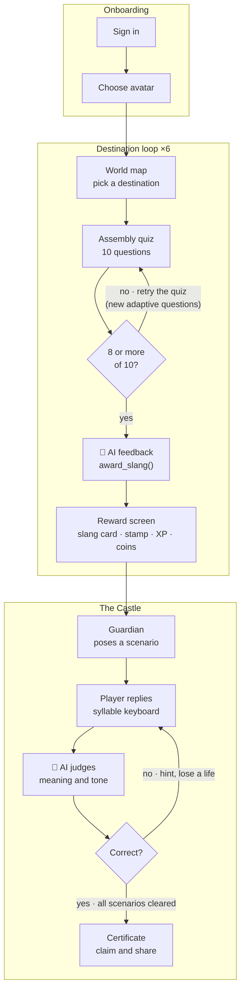
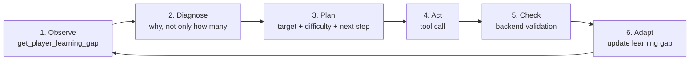
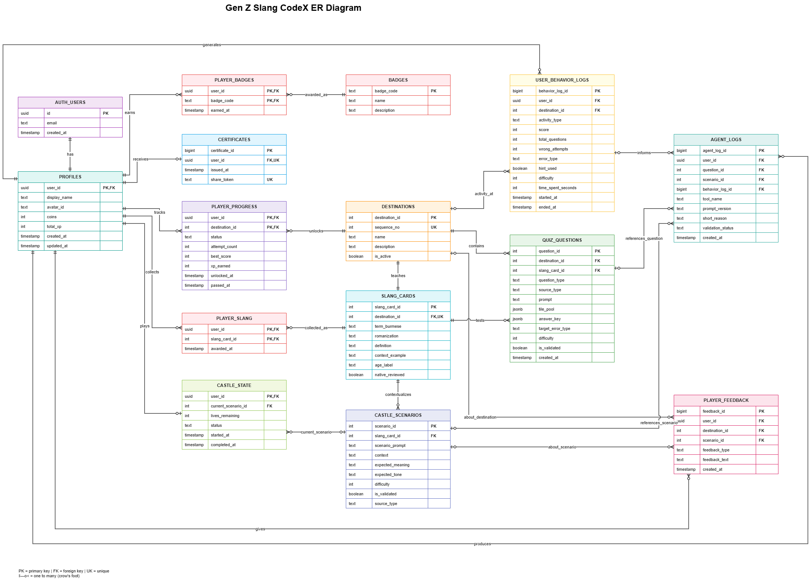
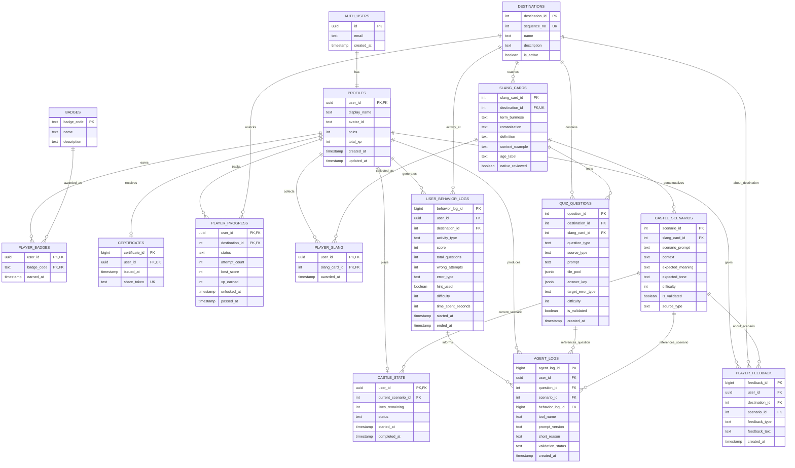

# GenZ Slang CodeX
<<<<<<< HEAD
**A Gamified Burmese Slang Game with an Adaptive AI Tutor Agent**  
=======
**A Gamified Burmese Slang Game with an Adaptive AI Tutor Agent** 
>>>>>>> 16ee977b66489009b575b81161f37e0df2fe7c4d

*1305394 Seminar in Software Engineering · Project Proposal (condensed draft v3, 17/10/2026)*

| | |
|---|---|
| **Team** | GenZ CodeX Team · Girl Power |
| **Members** | 6731503071 – Nang Phyo Thet Thet Khaing · 6731503080 – Pann Nu Nwe Soe · 6731503090 – Thoon Nady San |
| **Faculty advisor** | Ajr. Nang Hsu Mon Pyae |
| **Platform** | React game, landscape (final platform to confirm) |
| **Keywords** | Burmese slang; gamified language learning; Burmese script assembly; adaptive tutoring; tool-augmented ReAct agent; semantic evaluation |

> **Tip for VS Code:** press `Ctrl+Shift+V` (Mac: `Cmd+Shift+V`) to open the Markdown preview. To see the Mermaid diagrams in the preview, install the extension **"Markdown Preview Mermaid Support"** (bierner.markdown-mermaid). Keep `er-diagram.png` in the same folder as this file.

## Table of Contents
1. [Executive Summary](#executive-summary)
2. [Problem & Context](#2-problem--context)
3. [Evidence & Motivation](#3-evidence--motivation)
4. [Related Work](#4-related-work)
5. [Objectives & Research Questions](#5-objectives--research-questions)
6. [Scope](#6-scope-in--out)
7. [Method / Approach](#7-method--approach)
8. [Expected Outcomes](#8-expected-outcomes)
9. [Timeline & Risks](#9-timeline--risks)
10. [Ethics, Data & Privacy](#10-ethics-data--privacy)
11. [Appendix A: Decisions to Confirm](#appendix-a-decisions-to-confirm)
12. [Appendix C: Glossary](#appendix-c-glossary)
13. [References](#references)

---

## Executive Summary

Learners of Burmese can study formal grammar and still not understand how younger speakers write and text. Most apps test recall with fixed questions, give every learner the same path, and rarely check whether a phrase fits a real situation.

GenZ Slang CodeX teaches conversational Burmese slang through a map game across **six Myanmar destinations**. At each destination, players build words from consonants, vowels, and tone marks. Scoring **8 out of 10** unlocks a slang card. After all six cards are collected, players enter the **AI Castle**, a chat test that judges meaning and tone rather than exact keywords.

What makes the game different is its **adaptive tutor agent**, powered by Gemini. For each player it reads the learning-gap numbers, works out the likely cause of repeated mistakes, decides what the next question should target, and creates that question on the spot. It then explains the player's specific mistake, gives hints at the right level, and suggests what to review. The agent acts only through **six validated tools**, and the backend keeps control of scoring, rewards, lives and unlocking, so the AI never decides the outcome of the game.

**First release (this semester):** clickable UI mockups, six native-verified slang terms with contextual examples, a seed bank of 60 draft questions (10 per destination), paper specifications for the six agent tools, the allow-list and the database schema, and a prompt-only test of the agent in Gemini with no backend. Running the agent inside the game, frontend/backend implementation, and deployment are parked for Senior Projects 1 & 2.

---

## 1. Title, Team & Pitch

**One-sentence pitch:** Learners can read formal Burmese but cannot compose script or use current slang in context, so we are building a game that teaches script by assembly, adapts each question to the player's weak spot, rewards mastery with slang cards, and checks real understanding in a chat judged by an AI agent that acts only through validated tools.

**Roles (owners to be assigned):** product and game design; UI/UX and art; React frontend; backend and AI; Burmese content and QA; testing and documentation. One person may hold more than one role.

## 2. Problem & Context

Burmese learners meet four recurring problems:

- **Slang changes faster than textbooks.** Formal study does not explain how younger speakers actually text.
- **Burmese script is hard to practice.** Consonants, vowels and tone marks combine into syllables, and passive recognition does not build the skill of composing them.
- **Conversation practice is scarce.** Learners rarely get feedback on whether a phrase fits the context.
- **Fixed practice does not adapt.** Every learner gets the same questions, even when their mistakes differ, so strong learners are bored and weak spots are not addressed.

**Primary users:** learners of conversational Burmese, including heritage speakers who understand the language but not current slang, and Gen Z / young adult players comfortable with mobile games and chat interfaces. *To confirm: exact age range and assumed starting level.*

**Current workaround and its cost:** textbooks and recall-based apps. The cost is formal register, fixed answers, a one-size-fits-all path, and no judgement of tone or context.

## 3. Evidence & Motivation

The problems above are team assumptions. No learner evidence has been collected yet, so the plan below makes collecting it an explicit step.

| # | When | Method | What it should tell us |
|---|------|--------|------------------------|
| 1 | W4–W7 | Native-speaker review | Whether the six slang terms, examples and age suitability are accurate and current |
| 2 | W4–W6 | Learner interviews (3–5) | Whether heritage speakers and learners recognize the four problems |
| 3 | W12–W13 | Walkthrough of clickable designs (3–5 learners) | Where players are likely to get stuck in a destination and in the Castle, before anything is built |

**Why now:** language models make two things feasible that fixed quizzes cannot do: judging free text by meaning, and writing a new practice question that fits one learner. The risk is a model that misjudges slang or tone, or writes a wrong question. That is why the design keeps AI out of fixed-answer scoring, lets the backend check every generated question, and tests the agent against native-speaker labels.

## 4. Related Work

- **Gamified language learning.** Reviews suggest gamification can improve language learning and engagement [1]. Deterding et al. [2] provide a foundation for game-design elements in learning applications. Effectiveness for Burmese slang remains to be evaluated.
- **Adaptive tutoring.** VanLehn [11] reviews how well intelligent tutoring systems work; knowledge tracing [12] estimates what a learner has mastered; scaffolding [9] gives the idea of support that fits the learner and fades as skill grows. We borrow the idea, not the full machinery: the backend computes simple learning-gap numbers, and the agent reasons about them to choose the next question.
- **LLM judging and tutors.** Zheng et al. [3] found strong LLM judges reached over 80% agreement with human preferences in chatbot benchmarks. This does not establish accuracy for Burmese slang, meaning and tone, so we evaluate the agent against native-speaker-labelled responses.
- **Tool-using ReAct agents.** ReAct [4] combines reasoning with actions, allowing an LLM to request external tools. Our agent requests predefined tools, and the backend validates each action before changing game state.
- **Research gap.** Further literature review is needed to determine whether existing systems combine Burmese script-composition challenges, contextual slang evaluation, adaptive question generation, validated AI tool calls, and player-behaviour tracking.

## 5. Objectives & Research Questions

1. **Objective 1:** Teach one slang term per destination through ten script-building questions each (6 slang cards, 60 seed questions), with an 8-out-of-10 mastery gate (mastery learning [5]). Questions are fitted to the player by the agent and always checked by the backend.
2. **Objective 2:** Design the adaptive AI tutor agent and the AI Castle (built in Senior Projects 1 & 2), where the agent reasons about mistakes, judges meaning, tone and context, and acts only through six validated tools.
3. **Objective 3:** Evaluate the agent against native-speaker labels (at least 30 replies per slang term) and check whether generated questions are valid and aimed at the player's weak spot. This semester is a prompt-only test with no backend.
4. **Objective 4:** Record time, score, wrong attempts and error types to find destinations that need redesign. Needs the built game, so it happens in Senior Projects 1 & 2.

### RQ1: Judging
*Does an adaptive tutor agent that reasons over a player's mistake history give more targeted practice and feedback than a non-adaptive baseline, while its judging of replies stays within a 5% false-rejection limit?*

| Part | Detail |
|------|--------|
| Why it matters | Judging slang and tone is the main risk. An unfair fail costs the player a life and trust, so false rejections matter more than a lenient pass. |
| Sub-questions | (a) Does accuracy differ by reply type (correct, near miss, wrong register, wrong slang, literal)? (b) Do definitions and examples in the prompt reduce errors? (c) When not confident, does the agent ask the player to rephrase instead of failing them? |
| Hypothesis | With definitions and examples in the prompt, agreement with native-speaker labels reaches the target, and most remaining errors are near-miss and register cases. |
| How tested | Prompt-only test in Gemini with ≥30 native-labelled replies per slang term (180 total). Run 1 uses the first prompt; Run 2 the revised prompt; results compared. |
| Measures | Agreement %, false accepts, false rejections (target < 5%), accuracy per reply type, share of uncertain cases sent to "rephrase"; inter-annotator agreement where two native speakers label. |

### RQ2: Adapting
*Given a player's mistake history, can the agent create questions that target the player's weak spot and pass the backend validation?*

| Part | Detail |
|------|--------|
| Why it matters | Adaptive practice is the core idea. A wrong or mis-aimed generated question is worse than a fixed one, so the agent must diagnose the cause of mistakes, not only count them. |
| Sub-questions | (a) Does the generated question target the weak error type of the player profile? (b) Does it pass the backend validator first try? (c) Does the cause the agent states (e.g. script gap, not meaning gap) match the cause built into the profile? |
| Hypothesis | With learning-gap numbers in the prompt, the agent targets the weak spot more often than with the same prompt without them. |
| How tested | Prompt-only test with 5–6 simulated player profiles (vowel-sign errors, tone-mark errors, heavy hint use, fast and accurate, meaning confusion, mixed). Several questions per profile, generated with and without learning-gap data. Scored with a short rubric; a native speaker checks a sample of answer keys. |
| Measures | Share on target, share valid first try, share of correct diagnoses. Targets set after the first run. |
| Later (SP1 & 2) | With real players: do first-attempt pass rates and retries improve across attempts, and do players get faster and more accurate across Destinations 1–6? |

## 6. Scope: In / Out

| In scope (first release, built in SP1 & 2) | Out of scope (for now) |
|---|---|
| React game: sign-in, avatar, world map with six destinations, assembly challenge, Collection Book, Castle chat, certificate, settings, weekly leaderboard | Voice input and speech recognition |
| FastAPI backend with game rules, validation of generated questions, and the Gemini adaptive tutor agent with six tools | Interface languages other than Burmese and English |
| Supabase for authentication, progress, slang cards, Castle state, learning-gap data and behavior logs | Training or fine-tuning a custom AI model |
| Content: 6 slang cards, 60 seed assembly questions, Castle scenarios, music and sound effects | Real-time multiplayer (leaderboard only compares saved scores) |

---

## 7. Method / Approach HIHI

The game is **rules-first and agent-assisted**. The backend owns everything that must be fair and exact: scoring, the pass mark, rewards, lives and unlocking. The AI agent is used where judgement and personalisation are needed: choosing and creating the next question, judging free-text Castle replies, explaining mistakes, giving hints and recommending review. We do not train models; we wrap Gemini Flash [6] with backend code so it can take real action instead of only chatting.

### 7.1 System architecture

Six components: the React game, the Agent Controller, the Game Rules module, the Game Tools, the Gemini agent and Supabase. The Agent Controller is the only component that talks to all the others, so the AI never writes the database directly.

Per interaction: the app sends the answer and metrics → the backend applies game rules → the controller builds the prompt and allow-list → Gemini reasons and requests a tool call → the backend validates and executes it, writes to Supabase, returns the result to Gemini → Gemini writes the in-character reply.

.png>)

| Layer | Choice | Why |
|-------|--------|-----|
| Frontend | React | Map, drag-and-drop assembly, Castle chat, collection book, timer and metrics capture |
| Backend | Python with FastAPI [7] | Builds prompts and the allow-list, enforces game rules, validates generated questions and tool calls, computes learning-gap numbers, stores logs |
| Agent brain | Gemini Flash on Google Cloud Vertex AI | Reasons about the player, chooses a tool, writes questions. Vertex AI gives access control, quotas, usage monitoring and logging; Flash keeps latency and cost low. AI Studio is fine for this semester's prompt-only test. |
| Database and auth | Supabase [8] | Authentication, progress, slang cards, Castle state, avatar, learning-gap data, behavior and agent logs |

### 7.2 Game flow

Players sign in and choose an avatar, repeat the destination loop six times, then enter the Castle.

**Destination loop:** before each question, the agent reads the player's learning gap and generates the next assembly question for the approved slang term, fitted to the player's level and weak spot. The backend validates the question and its answer key before the player sees it. The player assembles the word, and the backend scores it. Each correct answer earns 100 points, so the pass mark of 8 correct is 800 of 1,000 points. On a wrong answer or a Hint tap, the agent explains the mistake or writes a hint. At 8 or more, the agent gives feedback, then the backend awards the slang card, stamps it into the Collection Book and unlocks the next destination. Below 8, the agent gives feedback and recommends what to review, and the player retries with new adaptive questions.

The first card is **အာလူးဖုတ်** (*Ah-loo-phoat*), meaning *to talk nonsense or exaggerate*. The other five terms are still to be chosen.

**The Castle:** opens once all six cards are collected. The AI Guardian poses a chat scenario created for the player's weak slang, the player replies on a syllable-assembly keyboard, and the agent judges meaning, tone and context. A correct reply moves to the next scenario. A wrong reply costs a life, and the agent can explain the mistake and give a hint. If the agent is not confident, it asks the player to rephrase and no life is lost. Clearing every scenario with lives left issues the certificate. Losing all lives sends the player to review mode, where the agent recommends which cards and skills to revisit.

### 7.3 Gamification

| Characteristic | Our application |
|---|---|
| Scaffolding | Destinations unlock in order so difficulty ramps [9]. The agent adapts question difficulty to the player, and free contextual hints are available on demand. |
| Feedback | AI feedback after each passed destination and in-character Guardian replies. *Proposed:* sound and animation on correct and wrong tiles. |
| Time | *Proposed:* a generous timer with a speed bonus on destination quizzes. The Castle stays untimed. |
| XP | Level bar beside the avatar. 100 XP per passed destination plus 10 per correct answer; 300 XP for clearing the Castle. |
| Achievement badges | Six destination stamps, six slang cards and the Mastery Seal. *Proposed:* Perfect Run, No-Hint Hero, Slang Master, Flawless Guardian. |

Other elements already in the designs: avatar customization with traditional Burmese attire, three Castle lives (proposed value), a personalized certificate with share button, and a weekly leaderboard outside the main flow. Coins are earned only by playing, so nothing needs real money.

### 7.4 Agentic AI design

The agent is a **tool-augmented adaptive tutor agent** built on the ReAct pattern [4]: one reason → act → observe loop per player interaction. It uses data as evidence, thinks about what it means for this player, decides what to do next, acts through a tool, and checks the result. Conversation state lives in Supabase, not inside one long agent run; the backend loads progress, the target slang card, lives and hints into the prompt.

| Step | What the agent thinks and does | Tool / control |
|---|---|---|
| 1. Observe | Reads the learning gap: weak terms, repeated error types, hint use and trend | `get_player_learning_gap` (read-only) |
| 2. Diagnose | Asks why. Repeated vowel-sign errors with rising hint use point to a script-composition gap, not a meaning gap, so the fix differs | Agent reasoning, short reason logged |
| 3. Plan | Chooses target (approved term and error type) and difficulty, and whether the next step is a question, hint, feedback or review | Allow-list for this situation |
| 4. Act | Creates the question, judges the reply, writes the hint or feedback, or recommends review | `generate_question`, `evaluate_answer`, `get_hint`, `give_feedback`, `recommend_review` |
| 5. Check | Backend validates the output. If a question fails, the agent receives the reason, regenerates once, otherwise the backend serves a seed-bank question | Backend validation |
| 6. Adapt | Result updates the learning gap. Difficulty steps up after consecutive correct answers and down after repeated errors (proposed rule, values to tune) | Backend computes numbers, agent decides how to use them |

**Example.** A player misses three of the last four questions on the same vowel-sign pattern and has tapped Hint twice. The agent reasons that the problem is vowel-sign placement, not the meaning of the slang term, and plans an easier question that isolates that pattern for the same approved term. The backend validates the question and answer key. After the player answers, the agent explains this exact mistake with one tip, and the backend updates the learning gap. The agent's short reasons are saved in the log so the team can audit and improve its decisions.

#### Agent tools (6)

| Tool | Used in | What it does | Backend checks |
|---|---|---|---|
| `generate_question` | Destinations and Castle | Creates the next question on the spot, fitted to the player's level and weak spot (assembly question in a destination; chat scenario in the Castle) | Valid format and difficulty, approved term only, no duplicates, answer key passes validator |
| `evaluate_answer` | Castle (free text) | Judges meaning, tone and context; returns verdict, confidence and reason | Valid verdict. Low confidence → "rephrase", no life lost |
| `give_feedback` | Destinations and Castle | Explains this player's specific mistake with one tip and optional model reply | Length and format, approved term only, no personal data, then saved |
| `get_hint` | Destinations and Castle | Writes a hint at the right level for the current question and mistake | Backend deducts the 25-coin cost only if the player has enough coins |
| `get_player_learning_gap` | Destinations and Castle | Returns weak terms, repeated error types, hint use and trend | Read-only, own data only |
| `recommend_review` | After failed quiz or at zero lives | Chooses what to revisit and why | Lesson IDs exist and are unlocked |

#### Allow-list per situation

| Situation | Agent tools allowed |
|---|---|
| Destination quiz, before each question | `get_player_learning_gap`, `generate_question` |
| Destination quiz, wrong answer or Hint tapped | `give_feedback`, `get_hint` |
| Destination passed | `give_feedback` |
| Destination failed (below 8) | `get_player_learning_gap`, `give_feedback`, `recommend_review` |
| Castle reply | `evaluate_answer`, `get_player_learning_gap`, `generate_question`, `give_feedback`, `get_hint` |
| Lives zero or review mode | `get_player_learning_gap`, `generate_question`, `recommend_review`, `give_feedback` |

#### Still handled by the backend (not agent tools)
- Score counting and the 8/10 pass rule
- `award_slang`, stamps and XP, only after a recorded pass
- `deduct_life`, `advance_scenario` and `issue_certificate`
- Unlocking destinations
- Prompt building and the allow-list
- Validating every generated question and its answer key
- Computing the learning-gap numbers
- Logging every generated question and tool call with the prompt version

#### Guardrails
- **The agent suggests, the backend decides.** The agent cannot award slang, change lives, advance a scenario, issue a certificate or unlock anything. It can only create content, judge, explain and recommend.
- The backend validates every call and every generated question, including that the answer key is correct for an approved term, before the player sees it. Awarding the same slang twice creates no duplicate.
- **Player text is data.** Instructions hidden in a reply are ignored. Every question, tool call and result is logged with the prompt version for audit.
- **Failure handling.** If a generated question fails validation, retry once with the reason, then use a seed-bank question. If Gemini times out, retry once, keep the saved quiz result and let the player retry the AI step. If a database write fails, never tell the player it succeeded. If a Castle judgement is uncertain, ask the player to rephrase before any life is lost.

### 7.5 Data and behavior tracking

The frontend records start and end time, score, wrong attempts and the error type of each wrong answer for every quiz or Castle session. The backend validates them, turns them into the learning-gap numbers (weak terms, repeated error types, hint use, trend), and stores them in `user_behavior_logs`. The same Supabase database holds `profiles`, `destinations`, `slang_cards`, `quiz_questions` (seed bank + accepted generated questions), `player_progress`, `player_slang`, `castle_scenarios`, `castle_state`, `certificates`, `player_badges`, `player_feedback` and `agent_logs`. The logs are used to adapt questions to each player, to compare Destinations 1–6, and to flag destinations that need redesign.

#### ER Diagram

Image version (from draw.io):

<<<<<<< HEAD

=======

>>>>>>> origin/main

Mermaid version (renders in VS Code with the Mermaid extension, and on GitHub):

> **Note:** the Mermaid version uses `term_burmese` for the slang-card term column, because the draw.io image lists it as `term_burmese`. Double-check column names against the PNG before writing SQL; the PNG is the source of truth.

### 7.6 Evaluation design

This semester only the first three metrics are measured, with prompt-only tests. The other three need the built game and are measured in Senior Projects 1 & 2.

| Metric | Operational definition | Target / report |
|---|---|---|
| Agent judgement accuracy | Agreement with a native-speaker-labelled test set of ≥30 replies per slang term (correct, near miss, wrong register, wrong slang, literal) | Report accuracy and false accepts |
| False rejections | Correct replies that the agent marks wrong, because unfair failure hurts trust more than a lenient pass | < 5% (proposed) |
| Question validity and fit | With 5–6 simulated player profiles: share of generated questions that pass the validator first try and target the profile's weak spot, and share of diagnoses that match the profile (short rubric; native speaker reviews a sample of answer keys; compared with a prompt without learning-gap data) | Report; targets set after first run |
| Learning | First-attempt pass rate and average retries per destination | Report *(SP1 & 2)* |
| Mastery | Share of players who complete the Castle and average lives left | Report *(SP1 & 2)* |
| Design health | Destinations flagged as unusually slow or error-prone in behavior logs | Flag for redesign *(SP1 & 2)* |

The semantic-judging approach follows the LLM-as-a-judge idea [3], with native-speaker labels as the reference. Failures are studied, the prompt and examples improved, and the test re-run until the target is met, then the prompt version is frozen.

**Supporting checks:** unit tests (scoring, pass rule, coins, lives, tool and question validation), integration tests of the full loop, rendering tests of the tile pool and keyboard on several phones and fonts, performance and cost per player journey, and security checks (token handling, row-level security, key exposure).

---

## 8. Expected Outcomes

- **Artifact:** clickable designs of the full flow (six destinations, Collection Book, Castle), with Destination 1 (assembly challenge, hint button, pass rule) as the detailed prototype. No working code or database yet.
- **Content pack:** six slang terms checked by native speakers, with sixty draft seed questions across destinations.
- **Agent specification:** the six agent tools, allow-list per situation, backend validation rules and the agent's thinking loop, written on paper with the database schema.
- **Evaluation:** learner interviews (3–5), clickable UI usability tests (3–5 learners), and prompt-only agent tests in Gemini (judging against native-labelled replies; question generation with simulated profiles).
- **Documents:** this proposal, the final paper, a demo of the clickable designs, and SP1 handoff notes.

## 9. Timeline & Risks

This plan covers semester 1 only (course weeks 10–15): research, design and clickable designs. No frontend, backend or deployment, and no agent testing inside the game.

| Weeks | Phase | Milestones |
|---|---|---|
| 1–3 | Scoping | Confirm advisor and roles, close Appendix A decisions, write requirements, shortlist the six slang terms |
| 4–7 | Evidence and literature | Finish literature survey, run learner interviews (3–5), native speakers review the six terms, examples and accepted replies |
| 8–11 | Design | Final screen designs (six destinations, six-slot Collection Book, Castle), game rules and scoring values, draft 60 seed questions and Castle scenarios, architecture, six agent tool specs, allow-list and Supabase schema on paper; native speakers start labelling test replies |
| 12–16 | Feasibility and report | Native speakers finish labelled replies (30+ per term); prompt-only agent tests in Gemini (judging, and question generation with simulated profiles); walkthrough of clickable designs with 3–5 learners; second run with revised prompt; review of results and plan for semesters 2 and 3 |

### Key risks

| Risk | Impact | Mitigation |
|---|---|---|
| LLM misjudges Burmese slang or tone | Players marked wrong for correct answers | Test against labelled replies per term; include definitions and examples in the prompt; ask to rephrase before deducting a life |
| Generated question or answer key is wrong | The game teaches wrong Burmese | Approved terms only; backend answer-key validation; native-speaker review of a sample; seed-bank fallback |
| Adaptation misreads the player | Questions too hard/easy, or player stuck on one weakness | Backend limits how fast difficulty changes, mixes in review questions, hints never block progress; check with simulated profiles first |
| Burmese script input and rendering | Tile and syllable keyboards are error-prone; fonts differ by device | Unicode-compliant font, multi-device testing, backend input validation |
| Latency and API cost | Agent is called for questions as well as Castle replies | Flash model, prepare the next question while the player answers the current one, call the agent only when needed, cache fixed content, set cloud budget alerts |
| Unsafe or vulgar slang | Age suitability and reputation | Review every card, label strong language, set the age rating |
| Audio licensing | Unlicensed tracks can block release | Current references are YouTube links: verify licences or replace with royalty-free audio |
| Scope | Six destinations, avatar, Castle, adaptive agent and tracking is large | Build the vertical slice first (Destination 1 with the adaptive loop), then scale |

**Resources and costs (to estimate):** Gemini API cost per player journey on Vertex AI (measure in the prototype), a Supabase plan (check whether the free tier covers it), hosting for backend and app, licensed or royalty-free audio, Burmese Unicode fonts, and phones/tablets for device testing.

## 10. Ethics, Data & Privacy

- **Language accuracy:** at least one native Burmese speaker, ideally two of different ages or regions, reviews every slang card, example, acceptable reply and a sample of generated questions with their answer keys.
- **Respectful representation:** landmarks and traditional clothing (Gaung Baung, Htamein) shown accurately and without caricature, checked by a cultural reviewer.
- **Strong language and young players:** label vulgar slang and decide the age rating. If minors are expected users, check consent and data rules for their age and country before launch.
- **AI transparency and fair judging:** tell players that the Guardian and the questions are made by an AI, that the AI can be wrong, and that questions are checked before use; accept regional variants and valid paraphrases; *proposed:* a way to report a judgement or question they think is wrong.
- **Player data:** collect only the fields listed in 7.5. Every API call carries the player token and the backend never trusts a user id from the request body. Row-level security limits players to their own rows, API keys stay in the backend, and the agent never receives emails or other personal data; it sees only the player's own learning-gap numbers. Terms and Privacy are in Settings.
- **Healthy design:** hints cost coins but never block progress for good, and adaptive difficulty must not trap a player on questions that are too hard.

---

## Appendix A: Decisions to Confirm

| # | Decision | Current assumption / open question |
|---|---|---|
| 1 | Castle details | Three lives and six scenarios. Open: restart from the first or the failed scenario, and whether one scenario can test two slang terms |
| 2 | Tool call order on a wrong Castle answer | Agent calls `evaluate_answer` first; backend then applies `deduct_life`; agent may then call `give_feedback` and `get_hint`. Low confidence → rephrase, no life lost. To confirm whether feedback and hint are one step or two |
| 3 | Slang list and age rating | Only the first term is fixed. Choose the other five, review suitability, set the age rating |
| 4 | Reset Progress | Does it also delete the player's behavior logs and learning-gap data? |
| 5 | Adaptive rules | How many difficulty levels, and the rule for moving up or down. Values to tune with simulated profiles |
| 6 | Question timing | Generate each question just before it is shown, or prepare the next one while the player answers the current one (lower waiting time) |

## Appendix B: Figures and Screens

- Figure 1: system architecture (Section 7.1)
- Figure 2: game flow (Section 7.2)
- Figure 3: ER diagram (Section 7.5)

UI screen designs (landscape): Avatar selection, World Map, Destination 1 introduction, Assembly challenge, Collection Book, Castle chat, Certificate, Settings.

## Appendix C: Glossary

| Term | Meaning |
|---|---|
| Agentic AI | AI that decides on and triggers actions through tools, instead of only replying with text |
| Adaptive tutor agent | An agent that reads a learner's mistake history, reasons about the cause, and chooses the next question, hint or feedback to fit that learner |
| ReAct | Reason and Act. The model reasons, takes an action (a tool call), observes the result, then replies |
| Tool call | A structured request from Gemini asking the backend to run a named function |
| Allow-list | The short list of tools the agent may request in the current situation |
| Learning gap | Numbers computed by the backend from a player's history: weak terms, repeated error types, hint use and trend |
| Seed bank | The 60 hand-checked draft questions, used as examples in the prompt, as test cases and as a fallback |
| Answer-key validation | A backend check that a generated question has a correct answer for an approved term before the player sees it |
| Game Rules | The backend module that scores quizzes, applies the pass mark, rewards and lives, with no AI |
| Semantic evaluation | Judging the meaning of an answer instead of matching exact keywords |
| Slang card and stamp | A collectible entry for one slang term (script, pronunciation, meaning, examples), shown as a destination stamp in the Collection Book |
| Assembly challenge | An exercise where players build Burmese characters by dragging consonant, vowel and tone mark tiles |
| Byee and Thara | Terms in our design notes for consonants and vowels |
| Gaung Baung | A traditional Burmese head wrap, shown in the avatar attire |
| Htamein | A traditional Burmese wrap skirt, shown in the avatar attire |
| Supabase | The hosted database and authentication service |
| FastAPI | The Python framework for the backend |
| Vertex AI | Google Cloud's managed platform for running Gemini with access control, quotas and monitoring |
| XP | Measures progress and sets the level |

## References

1. "Gamification in EFL/ESL instruction: A systematic review of empirical research," *Frontiers in Psychology*, vol. 13, 2022, doi: 10.3389/fpsyg.2022.1030790. *(Author list to add.)*
2. S. Deterding, D. Dixon, R. Khaled, and L. Nacke, "From game design elements to gamefulness: Defining 'gamification'," in *Proc. 15th Int. Academic MindTrek Conf.*, Tampere, Finland, 2011, pp. 9–15, doi: 10.1145/2181037.2181040.
3. L. Zheng et al., "Judging LLM-as-a-judge with MT-Bench and Chatbot Arena," in *NeurIPS 2023, Datasets and Benchmarks Track*, arXiv:2306.05685.
4. S. Yao et al., "ReAct: Synergizing reasoning and acting in language models," in *ICLR*, 2023, arXiv:2210.03629.
5. B. S. Bloom, "Learning for mastery," *Evaluation Comment*, vol. 1, no. 2, pp. 1–12, 1968.
6. Gemini Team, Google, "Gemini: A family of highly capable multimodal models," arXiv:2312.11805, 2023.
7. "FastAPI documentation." https://fastapi.tiangolo.com
8. "Supabase documentation." https://supabase.com/docs
9. D. Wood, J. S. Bruner, and G. Ross, "The role of tutoring in problem solving," *J. Child Psychology and Psychiatry*, vol. 17, no. 2, pp. 89–100, 1976.
10. *Designing a Gamified Learning Platform to Foster Engagement in Higher Education.* *(Full citation to add.)*
11. K. VanLehn, "The relative effectiveness of human tutoring, intelligent tutoring systems, and other tutoring systems," *Educational Psychologist*, vol. 46, no. 4, pp. 197–221, 2011. *(Verify details.)*
12. A. T. Corbett and J. R. Anderson, "Knowledge tracing: Modeling the acquisition of procedural knowledge," *User Modeling and User-Adapted Interaction*, vol. 4, no. 4, pp. 253–278, 1995. *(Verify details.)*
